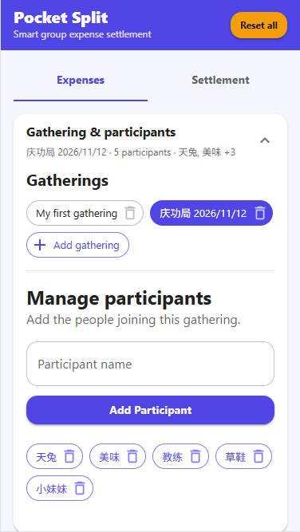
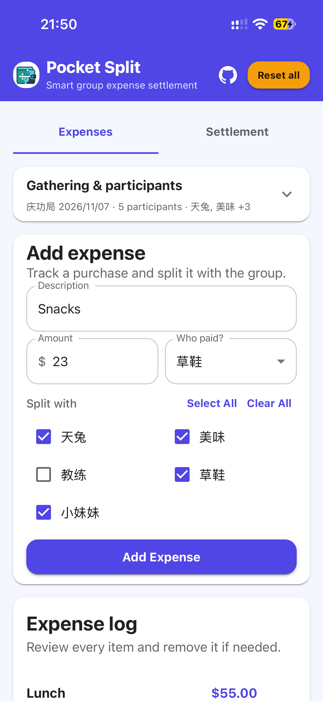
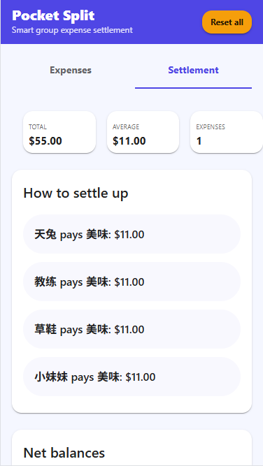

# Pocket Split 💸

A lightweight, 100% client-side web application built with React, TypeScript, and Material UI to track shared gathering expenses and calculate settlements without a backend.

## ✨ Features

- Create, save, switch between, and delete gatherings; each gathering keeps its participants and expenses separate
- Manage gatherings and participants together in a collapsible section
- Add expenses with per-expense payer and split-participant selection
- View gathering totals, average cost per participant, expense count, suggested transfers, and net balances
- Persist data in `localStorage`, including migration of older single-gathering data
- Use in-app confirmation dialogs to protect deletion and reset actions
- Responsive layouts for mobile, tablet, and desktop

## 🚀 Live App

[Open Pocket Split](https://ping-yuan.github.io/pocket-split/)

## 🖼️ Screenshots

### Gathering and participant management

Gatherings are selected, created, and deleted as chips in the collapsible management panel. Participants for the active gathering are managed in the same section.



### Add an expense

Enter the description, amount, payer, and participants sharing the expense. Split controls stay together in one row, and the add button remains easy to reach.



### Settlement results

The summary shows total spending, average per participant, expense count, suggested transfers, and net balances.



## 🚀 Local Development

1. Install dependencies: `npm install`
2. Start the development server: `npm run dev`
3. Build for production: `npm run build`
4. Run lint checks: `npm run lint`

## 📦 Deployment

For GitHub Pages, the Vite base path is configured as `/pocket-split/`. Run:

```powershell
npm run deploy
```

The deploy script builds the app, clears the local `gh-pages` cache, and publishes `dist` to the `gh-pages` branch of `Ping-YUAN/pocket-split`. After the first deployment, verify that GitHub Pages is enabled in the repository settings and uses the `gh-pages` branch with the root folder.

### Deployment troubleshooting

- **`Failed to get remote.origin.url` from `gh-pages`:** The deploy script already clears the local cache. If the error persists, run the cleanup explicitly and retry:
  ```powershell
  npx gh-pages-clean
  npm run deploy
  ```
- **`Repository not found`:** Check that `https://github.com/Ping-YUAN/pocket-split` exists and that the authenticated GitHub account has access. Inspect the configured remote with `git remote -v`; correct it if needed:
  ```powershell
  git remote set-url origin https://github.com/Ping-YUAN/pocket-split.git
  ```
- **`Invalid username or token` / authentication failure:** GitHub does not accept account passwords for Git over HTTPS. Install GitHub CLI with `winget install --id GitHub.cli`, reopen PowerShell, then authenticate:
  ```powershell
  gh auth login
  ```
  Choose GitHub.com, HTTPS, and browser-based login. If `gh` is still not recognized, restart the terminal or install GitHub CLI from [cli.github.com](https://cli.github.com/). If Windows is reusing stale credentials, remove the `github.com` entry in Windows Credential Manager and retry. Never put a token in the remote URL or commit it.
- **Deployment succeeds but the site shows 404 or old content:** Confirm GitHub Pages is configured to publish the `gh-pages` branch from `/ (root)`, ensure `vite.config.js` uses `base: '/pocket-split/'`, and allow a few minutes for GitHub Pages to update.

## 📜 License

MIT License. Feel free to use and modify this project for your gatherings.
