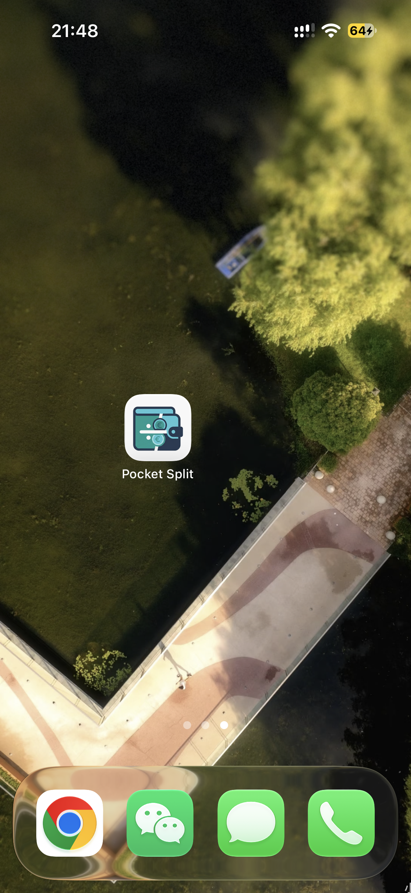
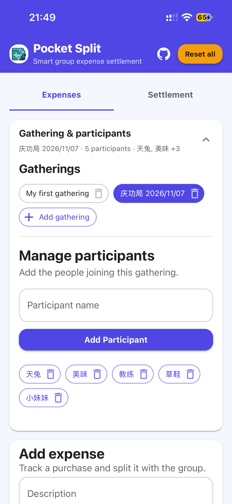
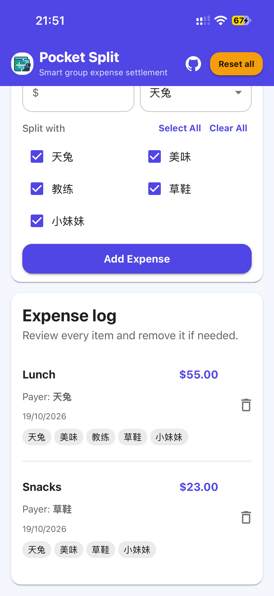
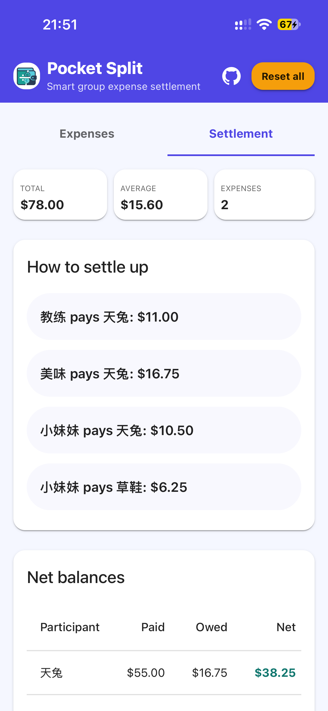

# Pocket Split 💸

A lightweight, 100% client-side web application built with React, TypeScript, and Material UI to track shared gathering expenses and calculate settlements without a backend.

## ✨ Features

- Create, save, switch between, and delete gatherings; each gathering keeps its participants and expenses separate
- Manage gatherings and participants together in a collapsible section
- Add expenses with per-expense payer and split-participant selection; descriptions are optional and default to `Expense by <payer name>`
- Clear all expenses from a gathering while keeping its participants for reuse
- View gathering totals, average cost per participant, expense count, suggested transfers, and net balances
- Persist data in `localStorage`, including migration of older single-gathering data
- Reopen the last loaded app shell and assets offline after the first successful online visit
- Use in-app confirmation dialogs to protect deletion and reset actions
- Add Pocket Split to an iPhone home screen with the custom app icon
- Responsive layouts for mobile, tablet, and desktop

## 🚀 Live App

[Open Pocket Split](https://ping-yuan.github.io/pocket-split/)

## 📱 Add Pocket Split to your home screen

Add a shortcut to the live app for quick access. It opens Pocket Split in your browser and keeps your data in that browser's local storage.

### iPhone or iPad (Safari)

1. Open [Pocket Split](https://ping-yuan.github.io/pocket-split/) in **Safari**.
2. Tap the **Share** button.
3. Scroll down and tap **Add to Home Screen**. If the option is not visible, choose **Edit Actions** and add it.
4. Keep or edit the name, then tap **Add**.

The home screen shortcut uses the Pocket Split icon. If you previously added the app, remove the old shortcut and add it again to refresh its icon.

### Android (Chrome)

1. Open [Pocket Split](https://ping-yuan.github.io/pocket-split/) in **Chrome**.
2. Tap the **⋮** menu.
3. Tap **Add to Home screen** (or **Install app** if Chrome offers that option).
4. Confirm the name and tap **Add** or **Install**.

On some Android browsers the menu wording differs; look for **Install app** or **Add to Home screen**. This creates a convenient home screen entry. Pocket Split currently saves data in the browser, so use the same browser to see the same saved gatherings.

### Use Pocket Split offline

The first visit must be online so the browser can download the app and its offline cache. After the page has loaded successfully once, the service worker caches the app shell and built assets; a later visit or refresh while offline can load that cached version. Your gatherings and expenses are stored separately in browser `localStorage`.

When a new version is deployed, the service worker updates its cache automatically while online. Open the app online after deployment to receive the latest version before going offline. Offline support requires a secure HTTPS site, which GitHub Pages provides.

## 🖼️ Screenshots

### 1. Open Pocket Split from your iPhone home screen

Add the app to your iPhone home screen for quick access. The custom app icon is shown below.



### 2. Set up a gathering and its participants

Create or select a gathering, then add the participants who will share its expenses.



### 3. Record shared expenses

Enter each expense's description, amount, payer, and split participants. Review or remove recorded expenses in the expense log.




### 4. Review settlement results

See total spending, average per participant, expense count, suggested transfers, and net balances for the selected gathering.



## 🚀 Local Development

Use Node.js `^20.19.0` or `>=22.12.0` and npm.

1. Install the locked dependencies: `npm ci`
2. Start the development server: `npm run dev`
3. Build for production: `npm run build`
4. Run lint checks: `npm run lint`
5. Check dependencies for known vulnerabilities: `npm audit`

## 📦 Deployment

For GitHub Pages, the Vite base path is configured as `/pocket-split/`. Run:

```powershell
npm run deploy
```

The deploy script builds the app, clears the local `gh-pages` cache, and publishes `dist` to the `gh-pages` branch of `Ping-YUAN/pocket-split`. After the first deployment, verify that GitHub Pages is enabled in the repository settings and uses the `gh-pages` branch with the root folder.

The custom home-screen icon is kept in `assets/apple-touch-icon.png` and bundled by Vite.

### Deployment troubleshooting

- **`Failed to get remote.origin.url` from `gh-pages`:** The deploy script already clears the local cache. If the error persists, run the cleanup explicitly and retry:
  ```powershell
  npx gh-pages-clean
  npm run deploy
  ```
- **`Repository not found`:** Check that `https://github.com/Ping-YUAN/pocket-split` exists and that the authenticated GitHub account has access. Inspect the configured remote with `git remote -v`; correct it if needed:
  ```powershell
  git remote set-url origin https://github.com/Ping-YUAN/pocket-split.git
  ```
- **`Invalid username or token` / authentication failure:** GitHub does not accept account passwords for Git over HTTPS. Install GitHub CLI with `winget install --id GitHub.cli`, reopen PowerShell, then authenticate:
  ```powershell
  gh auth login
  ```
  Choose GitHub.com, HTTPS, and browser-based login. If `gh` is still not recognized, restart the terminal or install GitHub CLI from [cli.github.com](https://cli.github.com/). If Windows is reusing stale credentials, remove the `github.com` entry in Windows Credential Manager and retry. Never put a token in the remote URL or commit it.
- **Deployment succeeds but the site shows 404 or old content:** Confirm GitHub Pages is configured to publish the `gh-pages` branch from `/ (root)`, ensure `vite.config.js` uses `base: '/pocket-split/'`, and allow a few minutes for GitHub Pages to update.

## 📜 License

MIT License. Feel free to use and modify this project for your gatherings.
